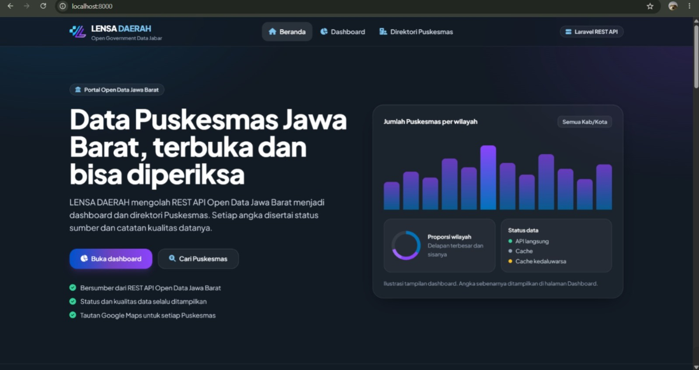

<h1>🏥 LENSA DAERAH</h1>

    

    Platform web untuk menyajikan data fasilitas kesehatan di Jawa Barat
    melalui REST API Open Data Jawa Barat secara transparan.

<h2>📌 Fitur Utama</h2>

<ul>
    <li><strong>Dashboard Transparansi:</strong> Statistik, grafik interaktif, dan data Puskesmas per Kabupaten/Kota.</li>
    <li><strong>Direktori Puskesmas:</strong> Daftar fasilitas kesehatan dengan filter kabupaten dan lokasi Google Maps.</li>
    <li><strong>Splash Screen:</strong> Animasi pembuka menggunakan GSAP.</li>
    <li><strong>Pencarian Data:</strong> Memudahkan pengguna menemukan informasi.</li>
</ul>

<h2>🛠️ Teknologi</h2>

<ul>
    <li><strong>Backend:</strong> Laravel (PHP)</li>
    <li><strong>Frontend:</strong> Blade Templates, Tailwind CSS</li>
    <li><strong>Animation:</strong> GSAP</li>
    <li><strong>Charts:</strong> Chart.js</li>
    <li><strong>Search &amp; Filter:</strong> Tom Select</li>
    <li><strong>Icons:</strong> Font Awesome</li>
</ul>

<h2>🎨 Design System</h2>

<ul>
    <li><strong>Font:</strong> Plus Jakarta Sans</li>
    <li><strong>Style:</strong> Modern Glassmorphism</li>
    <li><strong>Background:</strong> <code>#0B0F17</code></li>
    <li><strong>Accent Colors:</strong> <code>#0073BB</code>, <code>#6F42C1</code>, <code>#A166FF</code></li>
    <li><strong>Text Colors:</strong> <code>#F1F5F9</code>, <code>#94A3B8</code></li>
</ul>

<h2>🚀 Instalasi</h2>

<pre><code>git clone https://github.com/username/lensa-daerah.git
cd lensa-daerah
composer install
npm install
npm run build
cp .env.example .env
php artisan key:generate
php artisan serve</code></pre>

    Akses aplikasi melalui
    <a href="http://127.0.0.1:8000">http://127.0.0.1:8000</a>.

<h2>📊 Status Proyek</h2>

<ul>
    <li>✅ Splash Screen Interaktif</li>
    <li>✅ Landing Page</li>
    <li>✅ Dashboard Transparansi Data</li>
    <li>✅ Direktori Puskesmas</li>
</ul>

<strong>LENSA DAERAH</strong> — Transparansi Data Kesehatan Jawa Barat.

